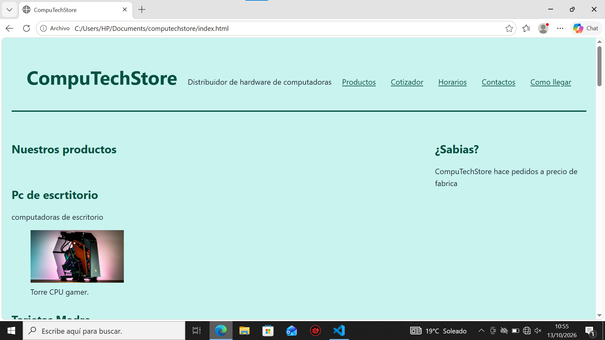

# [CompuTechStore]

**Estudiante:** [Ludwing Calani Mamamni]
**Cliente:** [Ludwing Calani Mamani]
**URL publicada:** [DESPUES, PROXIMA SEMANA]

## Qué resuelve
[2-3 frases: qué problema tiene tu cliente y cómo lo ayuda este sitio]
[
1. Tener que buscar los productos para poder mostrar el producto que el cliente desea
2. Antes tenia que cotizar el precio de forma manual
3. No se podía hacer pedidos de productos
4. Tamíen ahora puede llegar a muchas personas mediante la página]

## Cómo está construido
- **Semántica:** [qué elementos usaste y dónde]
html lang="es" antes de la cabecera para que reconozca la escritura en español head despues del html lang para inicio como cabecera de la página meta charset="UTF-8" despues de head permite mostrar tíldes meta name="viewport" despues del meta charset-"UTF-8" que configura el anchoo y la escla de la pantalla meta name="description" descripcion de la web bodydonde irá el cuerpo de la web main onde irá el menú section donde ira las seccionesh1h2 h3, article, title, link, nav,figure, img, figcaption, table, fieldset, label, input,select, option, textarea, button,  aside, adrress footer,

- **Layout:** [dónde Flexbox, dónde Grid, y por qué]
flexbox en estilos css para configurar manejo de una sola fila
grid para el manejo de dos dimenciones al mmismo tiempo
- **Diseño:** [paleta y tipografía, y por qué las elegiste]

Usé colores en combinacion colores con verde pra hacer llamativo a la pagina como verde como color principal de las letras principales como el nombre de la de la paginay el fondo un verde mas claro para que resalte las ltreas de lapágina


## Capturas

 DESPUES, PROXIMA SEMANA

## Lo más difícil
[Qué problema técnico te costó más y cómo lo resolviste. Sé específico:
"el menú se salía de la pantalla en móvil y lo resolví con flex-wrap"
vale; "fue difícil pero lo logré" no vale.]

lo mas dificil fue centrear se resolvió con justify-content space -between

Las imagenes que agregué despues no se podia ajustar el tamaño que yo queria,aun no lo resolví

agregar un enlave de facebook lo resolví ><a hrefs>

## LABORATORIO 2

- **JavaScript y Modularización:**
  - `datos.js`: Almacena la estructura de datos principal de la tienda con un arreglo de objetos `productos` (nombre, precio, categoría, stock y disponibilidad).
  - `funciones.js`: Prácticas de funciones declaradas, funciones flecha (arrow functions), cálculos de totales, descuentos, impuestos y closures.
  - `render.js`: Manipulación dinámica del DOM; se encarga de crear cada tarjeta con `crearTarjeta()` e insertarlas en `<div id="lista-productos">` mediante `render(lista)` sin sobreescribir el resto de la sección.
  - `app.js`: Manejo de constantes, variables, tipos de datos y actualización dinámica del mensaje de stock en `#aviso-stock`.
  - `eventos.js`: Gestión de eventos e interactividad:
    - Búsqueda en tiempo real mediante el evento `input` en `#buscador`.
    - Filtrado por categorías mediante delegación de eventos `click` en `#filtros`, actualizando visualmente la clase `.activo`.
    - Validación y control del formulario con el evento `submit`, cancelando el reinicio no deseado con `event.preventDefault()` y validando fechas.
    - Actualización del contador dinámico `#resultado`.

- **Controles y scripts integrados en `index.html`:**
  - Inclusión de scripts modulares al final del `<body>`:
    ```html
    <script src="datos.js"></script>
    <script src="funciones.js"></script>
    <script src="render.js"></script>
    <script src="app.js"></script>
    <script src="eventos.js"></script>
    ```
  - Contenedor de controles interactivos (`.controles`):
    - Campo de búsqueda: `<input type="search" id="buscador">` con etiqueta `<label for="buscador" class="visualmente-oculto">` para accesibilidad.
    - Botones de categorías: `<div id="filtros">` con botones interactivos y atributos `data-categoria` (`todos`, `RAM`, `procesador`, `tarjeta gráfica`, etc.).
  - Contador y mensajes de resultados: `<p id="resultado" aria-live="polite"></p>` para anunciar en vivo la cantidad de productos coincidentes.